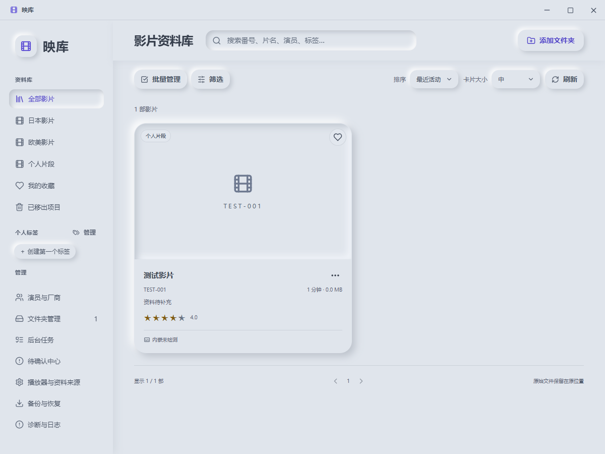

# 映库 · AV Library Manager

映库是一款 Windows 本地影片资料管理工具。将影片文件夹加入资料库后，可以通过封面浏览、搜索和整理影片，并使用外部播放器播放。



*界面示例使用测试数据。*

## 功能

- **本地资料库**支持扫描影片文件夹，并按自定义分类、标签和收藏组织影片。后台读取 Windows 提供的缩略图、时长和分辨率，也可以手动导入封面。
- **搜索与整理**支持按标题、番号、演员和标签搜索，使用收藏、评分和组合筛选整理资料，支持批量操作。
- **影片资料**包括片名、演员、厂商、简介、标签和个人笔记。联网资料可以按需手动获取，核对后保存。
- **播放与字幕**支持系统默认播放器、PotPlayer、mpv 和 VLC，可以匹配或手动选择外挂字幕。
- **备份与恢复**包含数据库、设置、个人资料和封面。原始视频与外部字幕需要另外备份。

影片资料保存在本地。扫描和浏览资料库不需要联网。联网资料查询由用户手动发起，设为「仅本地整理」的影片不会加入联网查询任务。

## 运行

需要 Windows x64、Microsoft Edge WebView2 Runtime，以及可用于播放影片的播放器。无需安装或配置 FFmpeg/FFprobe。

从 [Releases](https://github.com/zengbbxx11/AVLibrary/releases/latest) 下载 Windows x64 便携版，解压后运行 `AVLibrary.exe`。首次运行会在程序目录下创建 `app-data`，请将程序放在可写入的文件夹中。

1. 点击“添加文件夹”，选择影片所在目录和默认分类。
2. 等待扫描完成，影片会出现在资料库中。
3. 点击影片封面播放，点击片名查看详情，使用卡片上的菜单编辑资料。
4. 如需指定播放器或配置资料来源，打开“播放器与资料来源”。

`app-data` 保存数据库、设置和封面。迁移程序或更换电脑时，请关闭程序并一同保留该目录。如果媒体文件的位置改变，可以在“文件夹管理”中重新定位。

## 从源码构建

构建需要以下环境。

- Windows x64 和 WebView2 Runtime
- Node.js 24、npm
- Rust stable、MSVC 构建工具和 Windows SDK

在终端中克隆仓库并安装依赖。

```bash
git clone https://github.com/zengbbxx11/AVLibrary.git
cd AVLibrary
npm ci
```

运行以下命令启动桌面开发版。

```bash
npm run desktop:dev
```

运行以下命令构建 Windows 可执行文件。

```bash
npm run desktop:build
```

构建完成后，可执行文件位于 `src-tauri/target/release/av-library-manager.exe`。

## 测试

```bash
npm run build
npm test
npm run test:ui
cargo test --locked --manifest-path src-tauri/Cargo.toml
```

UI 测试使用 Chrome 或 Playwright Chromium。详细运行方式见[测试说明](docs/TESTING.md)。

## 文档

- [使用指南](docs/USER_GUIDE.md)
- [更新记录](docs/CHANGELOG.md)
- [诊断与日志](docs/DIAGNOSTICS_GUIDE.md)
- [第三方依赖说明](docs/THIRD_PARTY_NOTICES.txt)
